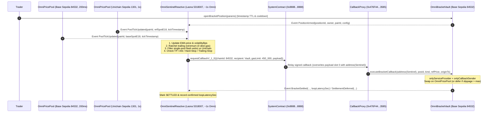

# OmniBracket Shield

**Sub-Second Cross-Chain OCO Bracket, Zero-Gas Trailing Stop, Anti-Wick & Cross-Pool Dislocation Engine for Reactive Omni**

Built natively on **Reactive Omni (`reactive-lib-omni`, `0x8888...8888`, ~1s CometBFT instant finality)** bridging **Base Sepolia (`84532`, `200ms` Denim blocks)** and **Unichain Sepolia (`1301`, `1s` blocks)**.

---

## 1. Why Reactive Omni (~1s Finality) Changes the Math

Since Base Sepolia's Denim upgrade (`200ms` block cadence, `5 blocks/sec`) and Unichain Sepolia (`1s` block cadence), DEX pools reprice **44 times** during a legacy `~8.8s` cross-chain automation loop:

1. **Trailing Stops Cannot Live Purely on Destination L2s**: Updating high-water marks on every `200ms` tick directly on Base Sepolia requires an off-chain keeper broadcasting up to `5 tx/sec` per user. `OmniSentinelReactive` tracks high/low-water marks directly inside `react()` on Reactive Network with **zero destination gas** until a stop or take-profit threshold is actually breached.
2. **Single-Chain Keepers Get Sandwiched by 1-Block Flash Wicks**: A flash-loan swap on a single `200ms` Base Sepolia block can wick spot price `-15%` and trigger naive stop-loss orders at the bottom of the sandwich. Because `OmniSentinelReactive` subscribes to `PoolTickUpdated` events across **both Base Sepolia (`84532`) and Unichain Sepolia (`1301`)**, it measures real-time cross-venue basis dislocation (`dislocationBps`) inside `react()` and filters isolated single-venue manipulation wicks automatically.
3. **Every Second Counts in Cascades & Cross-L2 Arbitrage**: Cutting reactive consensus from `~7s` down to **`~1s` CometBFT instant finality** reduces full-loop settlement latency from `~8.8s` (`44` Base Sepolia blocks) down to **`~1.6s` (`8` Base Sepolia blocks)** — preserving **`+619 bps` (`+$1,795.92` on a `10 WETH` position)** during a high-velocity cascade and turning cross-pool basis capture from `-14.4 bps` (expired spread) into **`+121.0 bps` net alpha**.

---

## 2. System Architecture



---

## 3. Reactive Omni Ground-Rule & Security Compliance

- **Native 2026 `reactive-lib-omni` (`^0.8.29`)**:
  - Inherits `@reactive/src/base/AbstractReactive.sol` (`SYSTEM = 0x8888888888888888888888888888888888888888`, `onlySystem`) and `@reactive/src/base/AbstractCallback.sol` (`onlyServiceProvider` + `onlyCallbackSender`).
  - Dispatches callbacks exclusively via `SYSTEM.requestCallbackV_1_0(ISystemContract.CallbackConfiguration_V_1_0({...}))` with `address(0)` reserved in the first payload argument slot.
- **Strict Timestamp Timers for Base Sepolia `200ms` Blocks**:
  - Zero `block.number` timers, cooldowns, or deadlines anywhere in Solidity. Every TTL (`expiresAt`), retry cooldown (`cooldownSec`), reference staleness window (`referenceMaxAgeSec`), in-flight timeout (`IN_FLIGHT_TIMEOUT_SEC`), and on-chain loop latency delta (`loopLatencySec`) uses `block.timestamp` / origin `tickTimestamp`.
- **Graceful Non-Reverting Callback Economy**:
  - Destination callbacks are billed regardless of revert outcome. After passing `onlyServiceProvider` and `onlyCallbackSender(reactiveSender_)`, `OmniBracketVault.executeBracketCallback` handles adverse slippage or race cancellations without reverting by emitting `SettlementDeferred`, allowing `OmniSentinelReactive` to unlock `IN_FLIGHT -> ACTIVE` cleanly after `cooldownSec`.
  - Both contracts expose `coverDebt()` and support reserve pre-funding via `depositTo(address)`.

---

## 4. Repository Layout

```text
├── contracts/
│   ├── interfaces/IOmniBracketTypes.sol   # Canonical Omni addresses, topic0 hashes, shared structs
│   ├── origin/MockERC20.sol               # 18-decimal vWETH / vUSDC testnet tokens
│   ├── origin/OmniPricePool.sol           # Constant-product AMM & sub-second tick emitter
│   ├── destination/OmniBracketVault.sol   # Non-custodial OCO & arb callback vault (AbstractCallback)
│   └── reactive/OmniSentinelReactive.sol  # Multi-origin stateful Reactive Omni engine (AbstractReactive)
├── script/
│   └── DeployAndTriggerOmni.s.sol         # 4-step live deployment + end-to-end trigger scripts
├── test/
│   ├── mocks/MockOmniNetwork.sol          # Byte-accurate 0x8888...8888 & CallbackProxy emulators
│   └── OmniBracketFullLoop.t.sol          # 17 Foundry E2E, security, anti-wick, gas-cap & 256-run fuzz tests
├── src/
│   ├── networks.ts                        # Chain definitions, Omni fee formula, payload encoder
│   ├── inspector.ts                       # Live Lasna / Base Sepolia / Unichain Sepolia RPC doctor
│   ├── latency-benchmark.ts               # Full-loop latency & slippage comparison engine
│   ├── live-loop.ts                       # Live testnet loop driver & millisecond latency recorder
│   └── cli.ts                             # CLI entrypoint (doctor | benchmark | fee-calc | live-loop)
└── tests/
    └── omni-toolkit.test.ts               # 10 Vitest unit tests for fee math, payload injection & benchmarks
```

---

## 5. Quickstart & Verification

### Prerequisites
- [Foundry](https://book.getfoundry.sh/) (`forge` / `cast` with `solc 0.8.29`)
- Node.js `>= 20` & `npm`

### 1. Build & Run Solidity Test Suite (17 Tests + 256 Fuzz Runs, Zero Warnings)
```bash
forge build --deny warnings
forge test -vv
```

### 2. Run TypeScript Unit Tests, Latency Benchmark & Live Network Doctor
```bash
npm install
npm run typecheck
npm test
npm run benchmark
npm run doctor
```

### Sample Benchmark Output (`npm run benchmark`)
| Architecture | Full Loop (`ms`) | Elapsed Base `200ms` Blocks | Crash Exit Price (`10 WETH`) | Capital Saved vs Legacy | Slippage Saved | Cross-L2 Arb Net | Anti-Wick Filter |
|---|---:|---:|---:|---:|---:|---:|:---:|
| **Reactive Omni (~1s CometBFT)** | **`1,600 ms`** | **`8` blocks** | **`$2,868.36`** | **`+$1,795.92`** | **`+619 bps`** | **`+121.0 bps`** | **YES** |
| Off-Chain Polling Keeper (`3s` poll) | `2,700 ms` | `14` blocks | `$2,837.52` | `+$1,488.45` | `+513 bps` | `+76.8 bps` | NO |
| Reactive Legacy (`~7s` block) | `8,800 ms` | `44` blocks | `$2,688.23` | `$0.00` | `0 bps` | `-14.4 bps` | YES |

---

## 6. Live Testnet Deployment & Full-Loop Execution (4-Step Order)

Because `OmniBracketVault` stores `_CALLBACK_SENDER` (`address(OmniSentinelReactive)`) immutably while `OmniSentinelReactive` routes callbacks to `vault`, follow the 4-step Reactive Omni deployment sequence:

### Step 0 — Obtain `lREACT` via Base Sepolia Faucet (`1 ETH -> 100 lREACT`, max `5 ETH`)
```bash
cast send 0x2afaFD298b23b62760711756088F75B7409f5967 \
  --rpc-url https://sepolia.base.org \
  --private-key $DEPLOYER_PRIVATE_KEY \
  "request(address)" $DEPLOYER_ADDR \
  --value 0.05ether
```

### Step 1 — Deploy Origin Pools on Base Sepolia (`84532`) & Unichain Sepolia (`1301`)
```bash
forge script script/DeployAndTriggerOmni.s.sol:DeployOriginPool \
  --rpc-url https://sepolia.base.org --broadcast

forge script script/DeployAndTriggerOmni.s.sol:DeployOriginPool \
  --rpc-url https://sepolia.unichain.org --broadcast
```

### Step 2 — Deploy `OmniSentinelReactive` on Reactive Lasna (`5318007`) & Verify via Sourcify
```bash
forge script script/DeployAndTriggerOmni.s.sol:DeployReactiveSentinel \
  --rpc-url https://lasna-rpc.rnk.dev/ --broadcast

forge verify-contract --verifier sourcify --chain-id 5318007 \
  $LASNA_SENTINEL_REACTIVE contracts/reactive/OmniSentinelReactive.sol:OmniSentinelReactive
```

### Step 3 — Deploy `OmniBracketVault` on Base Sepolia (`84532`) & Bind on Lasna
```bash
forge script script/DeployAndTriggerOmni.s.sol:DeployDestinationVault \
  --rpc-url https://sepolia.base.org --broadcast

forge script script/DeployAndTriggerOmni.s.sol:WireVaultOnLasna \
  --rpc-url https://lasna-rpc.rnk.dev/ --broadcast
```

### Step 4 — Trigger Live Cross-Chain Loop & Measure End-to-End Latency
```bash
npm run live-loop --all-three
```
Inspect callback delivery records directly on Reactive Lasna:
```bash
cast call 0x8888888888888888888888888888888888888888 \
  "getCallbacks(uint256)((uint256,address,uint256,uint256,uint256,bytes)[])" \
  $REACTIVE_TX_HASH --rpc-url https://lasna-rpc.rnk.dev/
```

### Live Verified Testnet Deployments, Proofs & `< 2m` Demo Video
- **Demo Video (`1m45s`, `1920x1080` `30fps`)**: [`docs/demo.mp4`](./docs/demo.mp4) | Interactive HTML5 Player: [`docs/index.html`](./docs/index.html)
- **Full On-Chain Proof Report**: [`LIVE_ONCHAIN_PROOFS.md`](./LIVE_ONCHAIN_PROOFS.md)
- **Base Sepolia Pool (`84532`)**: [`0xb16A318355Ecc265Afd0aCa51EE01C3f0aA91551`](https://sepolia.basescan.org/address/0xb16A318355Ecc265Afd0aCa51EE01C3f0aA91551)
- **Unichain Sepolia Pool (`1301`)**: [`0xb16A318355Ecc265Afd0aCa51EE01C3f0aA91551`](https://sepolia.uniscan.xyz/address/0xb16A318355Ecc265Afd0aCa51EE01C3f0aA91551)
- **Reactive Lasna Sentinel (`5318007`)**: [`0x2376EBA740136e63DBF172B8148B1D7362897857`](https://lasna.reactscan.net/address/0x2376EBA740136e63DBF172B8148B1D7362897857) *(Sourcify Verified)*
- **Base Sepolia Destination Vault (`84532`)**: [`0x24E60A1bcEB266DE6c44f0EE4e411e80fDD3289f`](https://sepolia.basescan.org/address/0x24E60A1bcEB266DE6c44f0EE4e411e80fDD3289f) *(Sourcify Verified)*
- **Live Reactive Full-Loop Proofs (Origin -> Reactive Lasna -> Destination Callback)**:
  - Loop 1 (Hard Stop-Loss): [`Origin 0x253bca...`](https://sepolia.basescan.org/tx/0x253bca14c49915d4c8bfa0125c82937a4790ffc1ea8e15d1aa32bb459915e061) -> [`Lasna 0x40d9ce...`](https://lasna.reactscan.net/tx/0x40d9cec9b511d8ba9f8ed0df53999ffa536704ed709a72c355a24466fdee156f) -> [`Callback 0xee5ba0...`](https://sepolia.basescan.org/tx/0xee5ba0a0160d6b2e607685fda4e1cdf73655295e96d56def21d343ceaab2d2eb) (`2,796 ms` wall-clock, `1 s` on-chain)
  - Loop 2 (Take-Profit): [`Origin 0x529eab...`](https://sepolia.basescan.org/tx/0x529eaba0133a218aea1269b708e1cce8e60700d05ab5492a8c6eeecc8e3a2e11) -> [`Lasna 0x2ef855...`](https://lasna.reactscan.net/tx/0x2ef855cbc83b744f9b465c5fd50c4ccf856d46f9bd161abd988886307a81a3ee) -> [`Callback 0xd80144...`](https://sepolia.basescan.org/tx/0xd8014433fdc376aab097ad3f630a87e4c0eabb22f5884e7b1e284c2a03f95b8f) (`3,428 ms` wall-clock, `1 s` on-chain)
  - Loop 3 (Trailing Stop): [`Origin 0x78c238...`](https://sepolia.basescan.org/tx/0x78c238fdbf039d8b0b338dbb8628d03b52b3918c5da885beab8c75524c2cbb8e) -> [`Lasna 0x320458...`](https://lasna.reactscan.net/tx/0x3204587016283d4c4a895bde817bad2b788ed851e6b352d5f6ce08919f2865ec) -> [`Callback 0x0497c0...`](https://sepolia.basescan.org/tx/0x0497c01950b0607d8c9de0fff11c2b8f214cd894d89659e866ee98971c236069) (`4,121 ms` wall-clock, `1 s` on-chain)

---

## License
MIT
